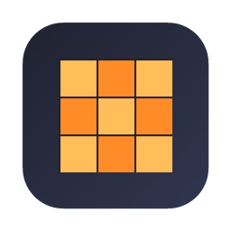
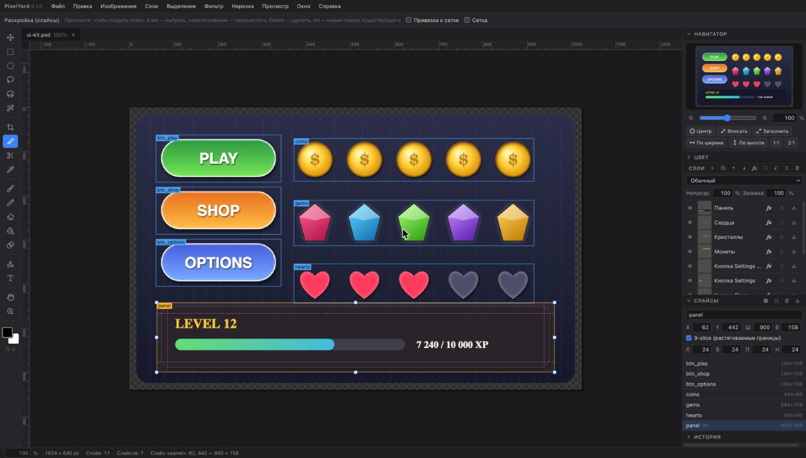
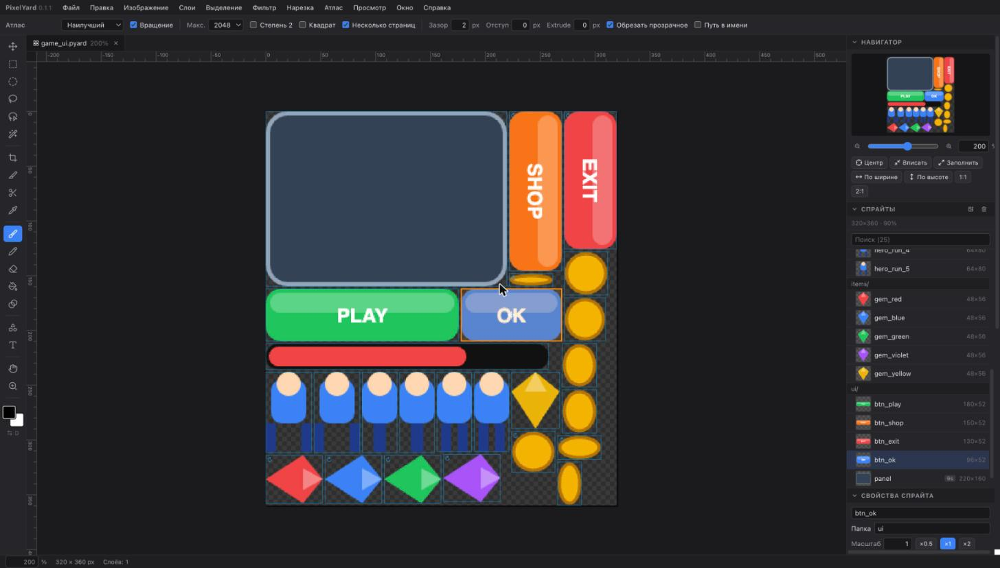
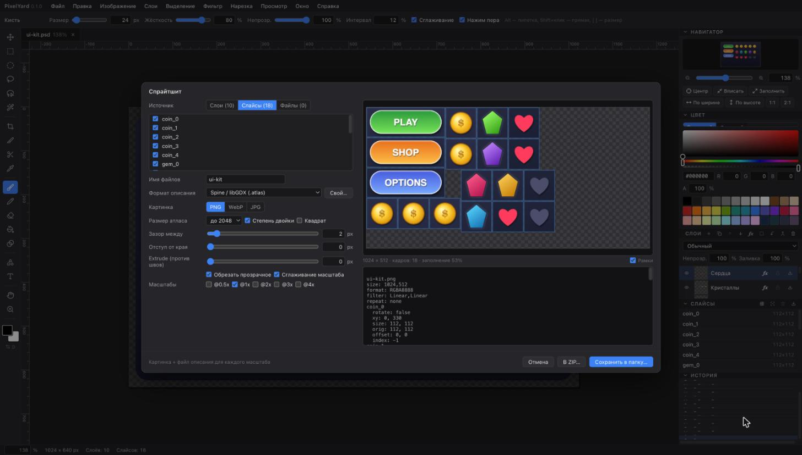
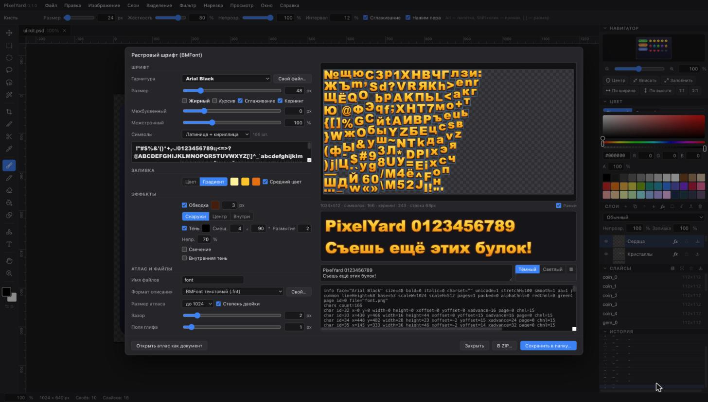
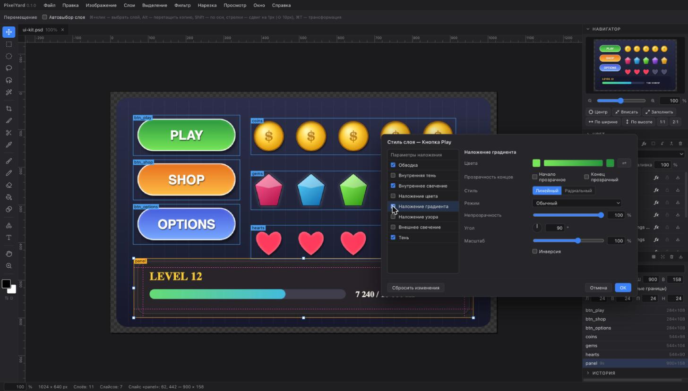
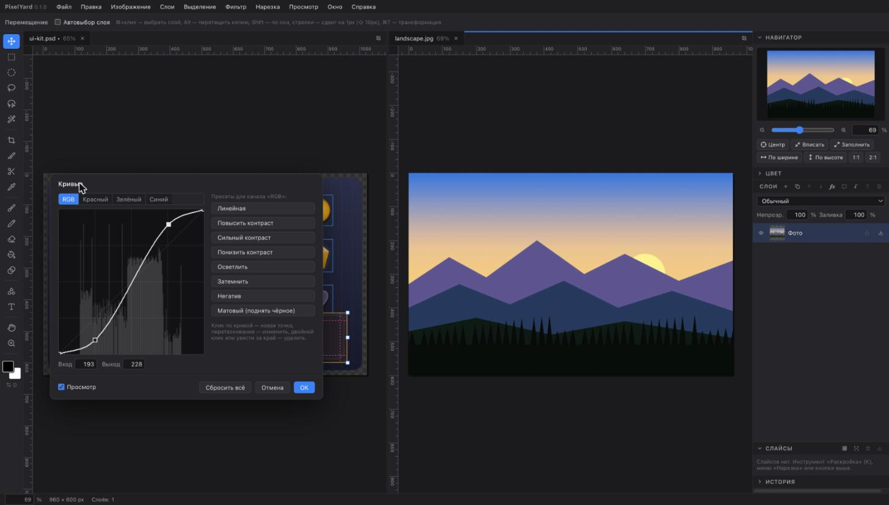
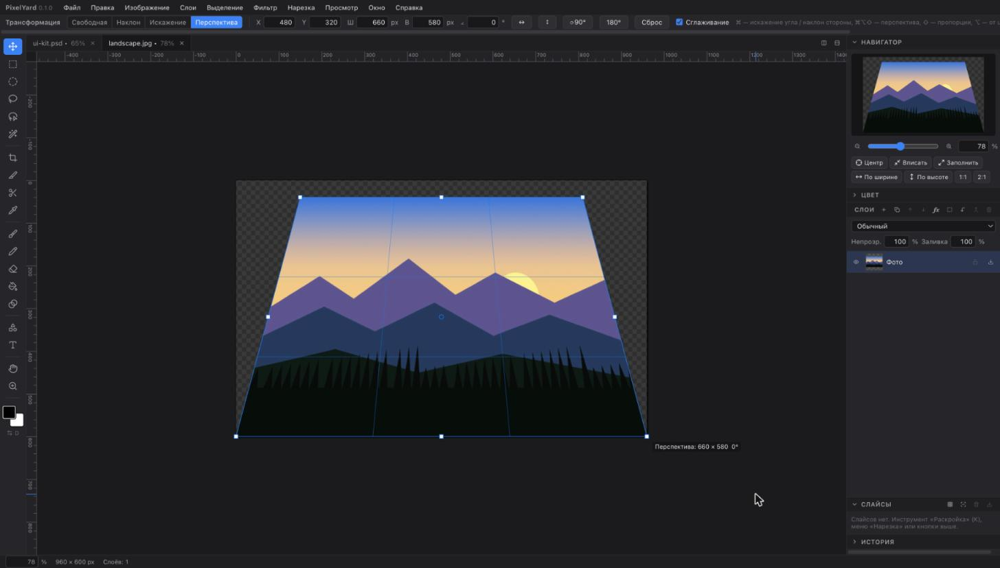
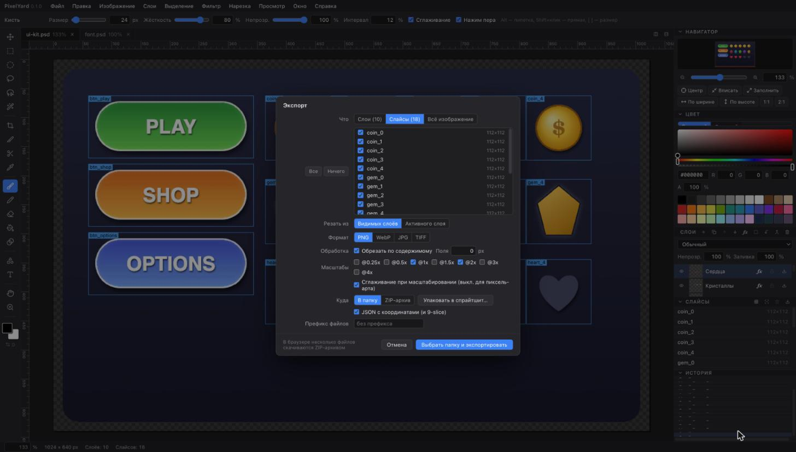

<p align="center">
  
</p>

<h1 align="center">PixelYard</h1>

<p align="center">
  <b>Редактор изображений для подготовки игровых и UI-ресурсов на macOS</b><br>
  нарезка · слои и стили · спрайтшиты · растровые шрифты · экспорт по одному файлу
</p>

<p align="center">
  <a href="https://github.com/veryevilzed/pixelyard/releases/latest"></a>
  
  
  
  
</p>

> **English:** PixelYard is a desktop image editor for game and UI asset preparation:
> layers with Photoshop-style effects and masks, slicing (grid, auto, knife, 9-slice),
> an atlas editor (multi-page atlases, rotation, live sprite editing, animations, 9-slice,
> export in several scales to TexturePacker / Phaser / Spine / Starling / Cocos / Unity / Godot
> or your own template, `.pyard` project files), BMFont bitmap-font generator, curves and colour adjustments, perspective
> transform, PSD in and out. The interface is in Russian.



## Скачать

**[Последняя версия →](https://github.com/veryevilzed/pixelyard/releases/latest)** — файл `PixelYard_*_universal.dmg`:
откройте его и перетащите PixelYard в «Программы». Сборка универсальная (Apple Silicon и Intel), macOS 11+,
подписана Developer ID и нотаризована Apple — открывается без предупреждений.
Что нового — в [CHANGELOG](CHANGELOG.md).

## Возможности

### Нарезка ресурсов
- **Слайсы:** рисуются мышью, двигаются, переименовываются, поддерживают **9-slice** (растягиваемые границы).
- **Нарезка сеткой** по количеству ячеек или по их размеру, с отступами и пропуском пустых ячеек.
- **Авто-нарезка по прозрачности:** находит отдельные объекты на прозрачном фоне.
- **Нож:** линии реза мышью, с шагом или по направляющим. Куски превращаются в слои или слайсы, или сразу сохраняются отдельными файлами.
- **Экспорт** каждого слоя или слайса в отдельный файл (PNG, WebP, JPG, TIFF): обрезка по содержимому, поля, масштабы @1x/@2x/@3x, JSON с координатами.

### Редактор атласов


- Атлас — отдельный документ-проект: спрайты по папкам, поиск, добавление файлов (перетаскиванием), слоёв или слайсов открытой картинки.
- **Клик по спрайту в атласе** — выделение, ⇧/⌘ и рамка — несколько сразу; свойства применяются ко всем выбранным: **масштаб**, обрезка, extrude, разрешение поворота, **опорная точка**, **9-slice**, папка.
- **Двойной клик — правка спрайта** в своей вкладке со слоями; атлас **перестраивается на лету** (удобно в сплите рядом).
- **Несколько страниц** (мультитекстура), **вращение** на 90° (выключается), расстановка: «наилучший» перебор, MaxRects с пятью эвристиками, полки, сетка, **по алфавиту**.
- **Анимации**: собираются по именам `run_0, run_1…` или из выбранных, fps и режим (повтор, туда-обратно, один раз), превью в панели.
- **Выгрузка сразу в нескольких масштабах** (×0.5, ×1, ×2, ×4 со своими суффиксами), **PNG / WebP / JPEG**, в папку или ZIP; настройки запоминаются.
- Форматы: TexturePacker JSON, **Phaser 3** (+ анимации), **Spine / libGDX**, Starling, Cocos2d, **Unity** (`.tpsheet`), **Godot 4** (`SpriteFrames .tres`), CSS, CSV, свои шаблоны.
- **Проект `.pyard`** — один файл (zip): спрайты, многослойные исходники (PSD), настройки и анимации. Открывается двойным кликом в Finder.

### Спрайтшиты


- Быстрая упаковка из слоёв, слайсов или **просто набора PNG-файлов**; кнопка «Открыть как проект атласа» переносит всё в редактор атласов.
- Обрезка прозрачного, зазоры, **extrude** против швов, размер степенью двойки или квадратом, несколько масштабов.
- Форматы описания: **TexturePacker JSON Hash и Array** (Pixi, Phaser 2), **Phaser 3**, **Spine / libGDX** `.atlas`, **Starling / Sparrow** XML, **Cocos2d** `.plist`, CSS-спрайты, CSV.
- **Свой формат** — шаблон с подстановками:

  ```
  {{#frames}}{{name}} = {{x}},{{y}},{{w}},{{h}}{{^last}},{{/last}}
  {{/frames}}
  ```

### Растровые шрифты (BMFont)


- Любой системный шрифт или свой TTF/OTF/WOFF. Наборы символов: ASCII, латиница + кириллица, цифры или свой.
- Заливка цветом или **градиентом по высоте строки**, одинаковым для всех букв.
- Эффекты: обводка, тень, свечение, внутренняя тень. Кернинг, межбуквенный и межстрочный интервал.
- Вывод: **BMFont `.fnt`** (текстовый и XML), JSON, **сетка** (только PNG или PNG + JSON), свой шаблон; картинка PNG или **WebP**.
- Атлас можно открыть обычным документом и дорисовать руками.

### Иконки, PDF, 9-slice
- **Иконка приложения** одним действием: Windows `.ico` (размеры на выбор), macOS `.icns`, favicon с `site.webmanifest`, iOS AppIcon, Android mipmap, набор для Tauri/Electron.
- **PDF**: открыть страницу или все страницы слоями (с белой подложкой или прозрачные); сохранить сведённо или каждый слой отдельной страницей.
- **Редактор 9-slice**: рисуете как обычно и сразу видите, как картинка тянется; экспорт в Android `.9.png`, PNG + JSON или растянутую картинку.
- **Растровые шрифты в тексте**: созданные в генераторе или открытые `.fnt` можно выбрать в инструменте «Текст».

### Слои и стили


- Папки слоёв и цветовые метки — сохраняются в PSD.
- 17 режимов наложения, непрозрачность и отдельно непрозрачность заливки.
- **Маски слоя** (чёрный скрывает, белый показывает) и **обтравочные маски**.
- **Стили слоя:** тень, внутренняя тень, внешнее и внутреннее свечение, наложение цвета, градиента и узора, обводка.
- Всё это сохраняется в **PSD** (эффекты — в формате Photoshop) и открывается обратно.

### Цвет и трансформации


- **Кривые** (каналы RGB/R/G/B, гистограмма, пресеты), уровни, яркость/контраст, цветовой тон/насыщенность, сочность.
- Цветовой баланс по тонам, чёрно-белое (6 цветовых ползунков), фотофильтр, температура и оттенок.
- Микширование каналов, карта градиента, тени/света, выборочная коррекция цвета.
- **Автотон, автоконтраст, автоцвет.**
- Фильтры: размытие, резкость, пикселизация, цвет в прозрачность, порог альфы, обводка контура, тень.



- Трансформация как в Photoshop: **свободная, наклон, искажение, перспектива**, с теми же модификаторами (⌘ / ⌘⌥⇧).
- Результат пересобирается точно, по проективному отображению.

### Рисование и выделение
- Кисть (жёсткость, интервал, сглаживание, нажим пера), **карандаш попиксельно** (pixel perfect), ластик.
- Заливка цветом или узором, градиент, фигуры, текст.
- Выделения: прямоугольник, эллипс, лассо, прямолинейное лассо, волшебная палочка, **цветовой диапазон**. Режимы сложения, вычитания и пересечения; расширить, сжать, растушевать.
- Выделенное — в новый документ, в новый слой, в маску; кадрирование по выделению.
- **Узоры:** определить из выделения, залить, наложить стилем.

### Рабочее место
- Вкладки документов перетаскиваются; **сплит экрана** — бросить вкладку к краю холста.
- **Навигатор** с рамкой видимой области, линейки, направляющие, сетка, привязка.
- История с переходом к любому шагу, горячие клавиши как в Photoshop (⌘/ — полный список).

### Форматы
| Открывает | Сохраняет |
|---|---|
| PSD (слои, маски, стили), TIFF (многостраничный — по слою на страницу), PNG, JPG, WebP, GIF, BMP, TGA, ICO, SVG, HEIC | PSD, PNG, JPG, WebP, TIFF |



## Сборка из исходников

Нужны macOS 11+, [Node.js](https://nodejs.org) 20+ и [Rust](https://rustup.rs).

```sh
git clone git@github.com:veryevilzed/pixelyard.git
cd pixelyard
npm install
npm run app:dev      # приложение с горячей перезагрузкой
npm run app:build    # .app и .dmg в src-tauri/target/release/bundle/
npm run dev          # только интерфейс в браузере: http://localhost:1420
```

### Подписанный релиз

```sh
npm run release              # спросит всё по шагам
npm run release -- --yes     # с сохранёнными ответами
npm run release -- --dry-run # показать план без выполнения
```

Работает как у Expo: спрашивает всё по очереди, сертификат получает сам.

1. **Организация Apple.** Выбор из сохранённых или «Добавить организацию». Нужен ключ App Store Connect API (Issuer ID, Key ID, `.p8`); инструмент подскажет, где его создать, и проверит запросом к Apple. Организаций может быть сколько угодно, они хранятся в `~/.config/apple-signing/teams.json`.
2. **Сертификат Developer ID Application.** Ищется у Apple и сверяется со связкой ключей. Если на этом Mac его нет, выпускается автоматически через API и импортируется вместе с ключом и промежуточными сертификатами Apple.
3. **Сборка, подпись, нотаризация тем же ключом.** К `.app` и `.dmg` прикрепляются тикеты, проверяется Gatekeeper, результат с `SHA256SUMS` кладётся в `release/<версия>/`.

Есть и ручной режим: сертификат из связки или `.p12`, нотаризация через Apple ID. Пароли и ключи в репозиторий не попадают.

## Стек

[Tauri 2](https://tauri.app) (Rust) · React 19 · TypeScript · Canvas 2D ·
[ag-psd](https://github.com/Agamnentzar/ag-psd) · [UTIF.js](https://github.com/photopea/UTIF.js) · [fflate](https://github.com/101arrowz/fflate) · libwebp

## Лицензия

[Apache License 2.0](LICENSE)
